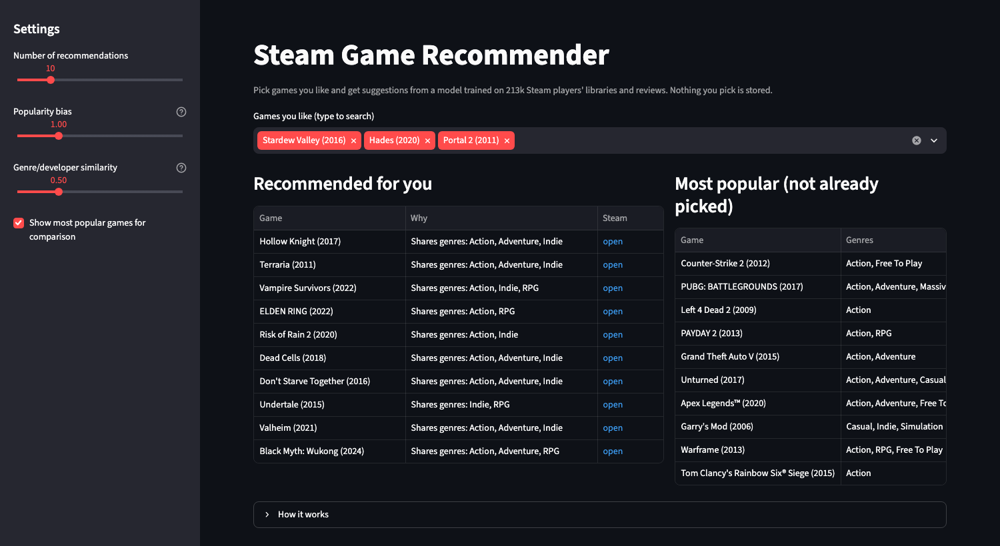
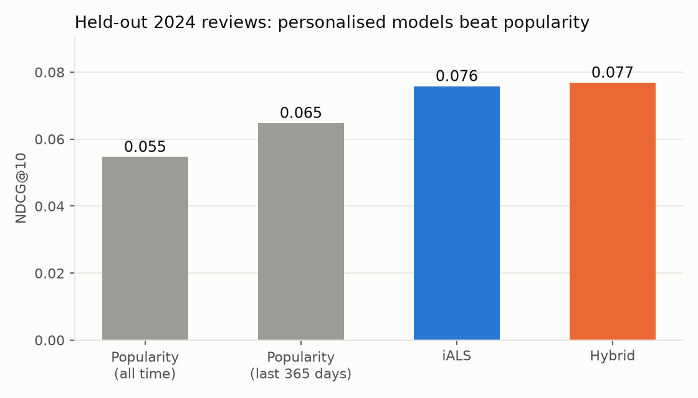
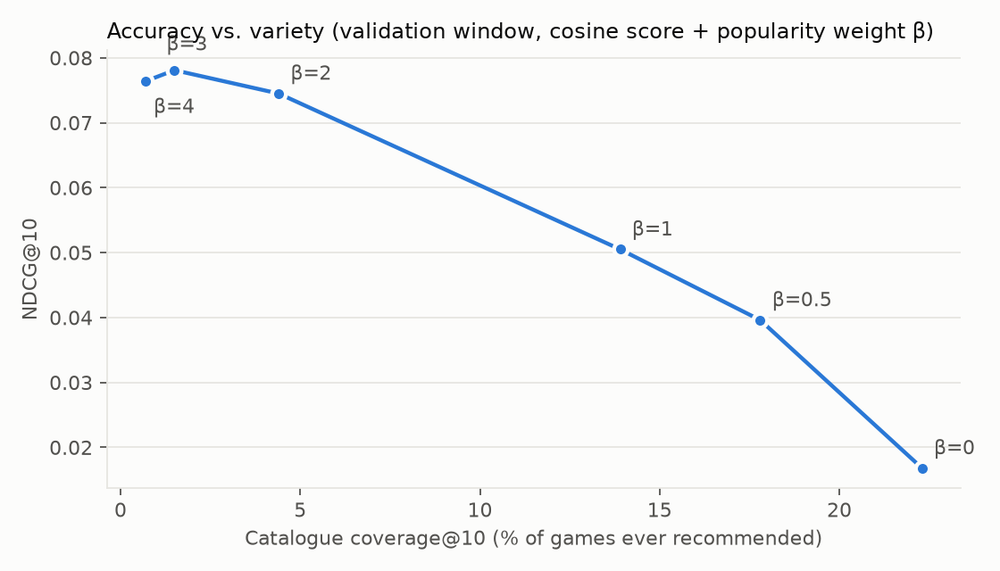
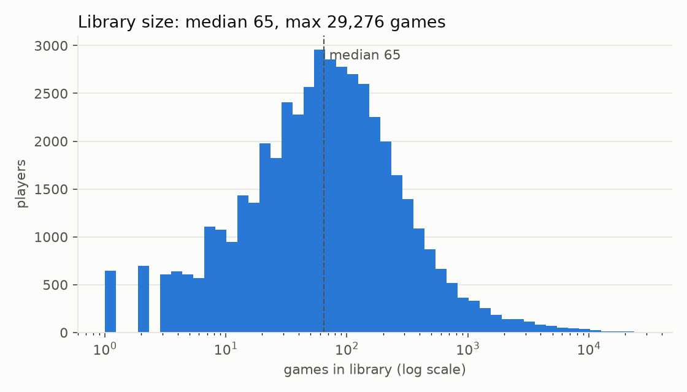
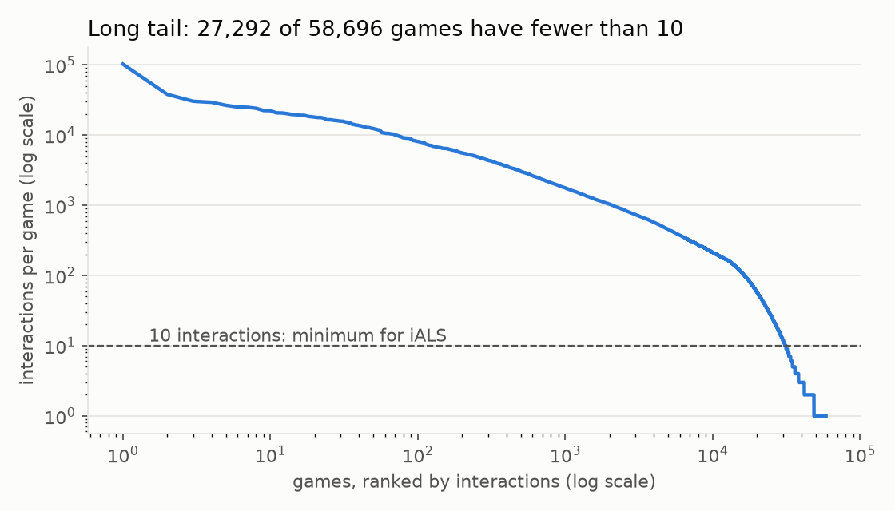
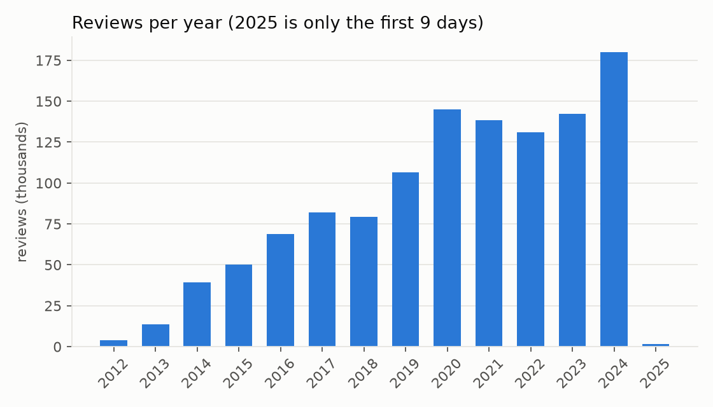

# Steam Game Recommender

Kaggle'daki [Gaming Profiles 2025](https://www.kaggle.com/datasets/artyomkruglov/gaming-profiles-2025-steam-playstation-xbox) veri setinin Steam kısmıyla yaptığım bir oyun öneri sistemi. Oyuncunun kütüphanesine ve yorumlarına bakıp ona 10 oyun öneriyor.

## Demo
[steam-game-recs.streamlit.app](https://steam-game-recs.streamlit.app)

https://github.com/user-attachments/assets/78f8225c-ff94-45cc-b04c-dd7e3e3b84db



## Nasıl ölçtüm
2024-01-01 öncesindeki veriyle modeli kurdum, sonra oyuncuların 2024'te gerçekten yorum yazdığı oyunları tahmin etmeye çalıştım. 36 bin oyuncu ve 30.9 bin aday oyun var.

Kütüphane tek bir anlık görüntü ve kütüphanesi olan oyuncuların yorumladığı oyunların %89'u kütüphanede de duruyor. Test oyunlarını kütüphane bilgisinden de çıkardım, yoksa model cevabı önceden görmüş oluyor.

## Sonuçlar
| model | NDCG@10 | Recall@10 | Coverage@10 |
|---|---|---|---|
| Popularity (tüm zaman) | 0.055 | 0.067 | 0.4% |
| Popularity (son 365 gün) | 0.065 | 0.085 | 0.2% |
| iALS (16 factor) | 0.076 | 0.103 | 8.2% |
| Hybrid (iALS + tür/geliştirici + popülerlik) | 0.077 | 0.104 | 3.5% |



iALS ve hybrid iki popularity baseline'ını da geçti. iALS'i beş farklı seed ile tekrar çalıştırdım, NDCG@10 0.0755 ile 0.0789 arasında çıktı. Hybrid her seed'de iALS'in biraz önünde ama fark sadece 0.0002-0.0008, pratikte aynı sayılır. Popülerlik terimi doğruluğu biraz artırıyor ama önerilen oyun çeşitliliğini (coverage) düşürüyor.

Bunun dışında iki şeye daha baktım:
- Kesim tarihini değiştirdim (2022, 2023 ortası, 2024 ortası). Sonuç genelde aynı kaldı. Tek istisna 2024'ün ikinci yarısı: orada son 365 günün popüler oyunlarını önermek iALS ile aynı seviyede (NDCG 0.0726'ya karşı 0.0722) ve Recall'da önde.
- Eğitimde 10'dan az etkileşimi olan yeni oyunlar çözülmedi. iALS bunları skorlayamıyor. Tür ve geliştirici özelliğiyle sıralayınca rastgeleden yaklaşık 4 kat iyi çıkıyor ama NDCG@10 sadece 0.0012.



## Veri hakkında notlar
Kütüphane boyutu çok geniş dağılıyor (medyan 65 oyun, en büyüğü 29 binden fazla), oyunların %46'sının 10'dan az etkileşimi var. Yorumlar son yıllarda yoğunlaşıyor.





- Oynama süresi yok, yıldız puanı da yok. Yorum yazmayı olumlu etkileşim saydım.
- 46.941 oyuncunun kütüphanesi dolu, 196.698 oyuncu yorum yazmış, ikisinden en az birine sahip olan 213.509 oyuncu var. Kütüphanesi NULL olanlar "boş" değil, "bilinmiyor".
- Başarım geçmişi sadece 4.838 oyuncuda var ve hepsi ağır başarım avcısı. Modelde kullanmadım.
- Kütüphanede tarih yok, yorumlarda var. Split'i yorum tarihine göre yaptım.
- Fiyatlar 2024-11-28'den başlıyor, kullanmadım.
- Platformlar arasında ortak kullanıcı anahtarı olmadığı için sadece Steam.

## Çalıştırmak için
```bash
pytest
python -m src.models.run_final --serve    # 2024 testi + uygulamanın model dosyaları
streamlit run app/streamlit_app.py
```
Ortam olarak conda'da `steamrec` kullandım (duckdb, implicit, scipy, streamlit). Sadece uygulamayı çalıştırmak için `app/requirements.txt` yeterli.

Ham veriden başlamak için önce `build_interactions()` (`src/data/load.py`), sonra `make_split()` (`src/evaluation/split.py`). Hiperparametre taramasını `src/models/tune_als.py` ile 2023 validation penceresinde yaptım, 2024 test seti tuning sırasında hiç kullanılmadı.

## Klasörler
- `notebooks`: EDA
- `src`: veri, özellikler, modeller, değerlendirme
- `app`: Streamlit uygulaması
- `models`: uygulamanın kullandığı model dosyaları
- `reports`: grafikler ve sonuç dosyaları (csv, json)
